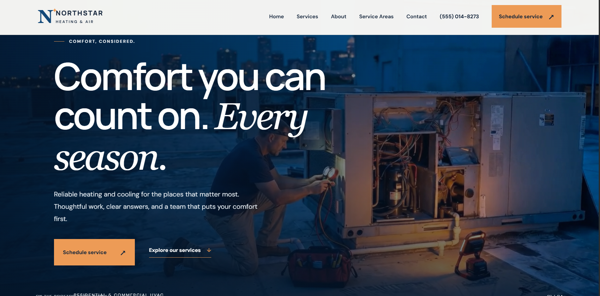

# Northstar Heating & Air

A responsive HVAC contractor website demonstration built as a polished front-end portfolio case study. The experience pairs a cinematic rooftop-service hero with clear service information, project concepts, and a straightforward appointment-request flow.

## Live demo

[View Northstar Heating & Air](https://northstar-hvac-website.vercel.app/)

## Screenshots

### Desktop



### Mobile


## Walkthrough

[Watch the website walkthrough](presentation/northstar-walkthrough.mp4)

## Project overview

Northstar Heating & Air is a fictional residential and commercial HVAC company created to demonstrate website design and front-end development for a home-services business. The single-page site guides visitors from the company’s service offering and approach through common questions to an appointment request.

## Key features

- Six HVAC service offerings covering heating, cooling, maintenance, and indoor air quality.
- Responsive navigation with a mobile menu and direct telephone link.
- Demonstration project showcase with concepts labeled as illustrative work.
- Sample testimonial clearly identified as fictional demonstration content.
- Interactive FAQ accordion.
- Appointment request form with client-side required-field and email validation, plus a confirmation state. Submissions are frontend-only: the form does not transmit or store information.
- Cinematic hero video with a poster image and reduced-motion fallback.

## Technologies

- HTML5
- CSS3
- Vanilla JavaScript

## Responsive design and user experience

The layout adapts for desktop, tablet, and mobile screens, with a dedicated mobile navigation pattern, flexible section layouts, and touch-friendly form controls. Semantic HTML, visible keyboard focus styles, and reduced-motion support are included.

## Project structure

```text
.
├── index.html
├── style.css
├── script.js
├── favicons/
├── referencesvideohvac-hero.mp4/
│   ├── video6005742174036041281.mp4
│   └── ezgif-frame-*.jpg
├── screenshots/
│   ├── desktop-homepage.png
│   └── mobile-homepage.jpg
└── presentation/
    └── northstar-walkthrough.mp4
```

## Run locally

From the project directory, start Python’s static file server:

```powershell
py -m http.server 4173
```

Then open [http://localhost:4173](http://localhost:4173) in your browser.

## Demonstration disclaimer

Northstar Heating & Air is a fictional portfolio project. Business details, service areas, project examples, and testimonial content are for demonstration only and do not represent a real contractor or verified customer feedback. The appointment form is a front-end demonstration; it does not send or save submissions.
